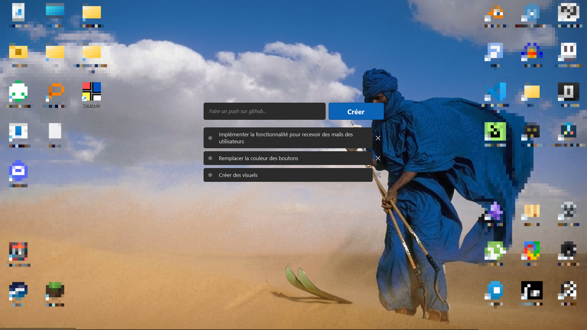

# To-do List

Une mini application de bureau pour garder ses tâches sous les yeux : une fenêtre transparente, posée au centre du bureau, qui se lance automatiquement au démarrage de Windows.



## Fonctionnalités

- **Fond transparent** : seules les cartes de tâches s'affichent, le fond d'écran reste visible derrière.
- **Ajout rapide** : tape une tâche puis appuie sur **Entrée** ou clique sur **Créer**.
- **Cocher / décocher** : un clic sur une tâche la marque comme faite (pastille bleue, texte barré).
- **Suppression** : un clic sur la croix à droite de la tâche.
- **Défilement** à la molette ou avec la barre fine à droite quand la liste dépasse la fenêtre.
- **Sauvegarde automatique** des tâches à chaque modification.
- **Lancement au démarrage de Windows** (désactivable).
- **Discrète** : absente de la barre des tâches et d'Alt+Tab, pilotée depuis une icône dans la zone de notification.

## Utilisation

L'icône de l'application se trouve dans la zone de notification, en bas à droite de la barre des tâches (flèche `^` des icônes cachées). Un clic droit dessus ouvre le menu :

| Action | Effet |
| --- | --- |
| **Afficher** (ou double-clic sur l'icône) | Réaffiche la fenêtre au centre de l'écran, par exemple après un `Win+D` |
| **Lancer au démarrage de Windows** | Active / désactive le lancement automatique |
| **Quitter** | Ferme l'application |

Les tâches sont enregistrées dans `%AppData%\To-do List\tasks.txt`.

## Installation

### Prérequis

- Windows 10 ou 11
- .NET Framework 4.7.2 (déjà inclus dans Windows 10 récent et Windows 11)

### Compiler depuis les sources

1. Ouvrir `To-do List.sln` dans **Visual Studio**.
2. Sélectionner la configuration **Release** dans la barre d'outils.
3. **Générer > Générer la solution** (`Ctrl+Maj+B`).
4. L'exécutable est créé dans `To-do List\bin\Release\To-do List.exe`.

### Installer

1. Copier `To-do List.exe` dans un dossier permanent, par exemple `%LocalAppData%\Programs\To-do List\`.
2. Le lancer une fois : il s'inscrit automatiquement au démarrage de Windows depuis cet emplacement.

## Structure du projet

```
To-do List/
├── Form1.cs                  Fenêtre principale, icône de notification et menu
├── Program.cs                Point d'entrée (instance unique, DPI, démarrage auto)
├── app.ico                   Icône de l'exécutable
├── Controls/
│   ├── PlaceholderTextBox.cs Champ de saisie avec texte indicatif
│   ├── RoundedButton.cs      Bouton « Créer »
│   ├── RoundedPanel.cs       Fond arrondi du champ de saisie
│   ├── TaskItemControl.cs    Une ligne de tâche (pastille, texte, croix)
│   └── TaskListPanel.cs      Liste défilable avec barre fine
└── Core/
    ├── Theme.cs              Couleurs, polices et dimensions
    ├── TaskItem.cs           Modèle d'une tâche
    ├── TaskStorage.cs        Lecture / écriture des tâches
    ├── StartupManager.cs     Inscription au démarrage de Windows
    ├── GraphicsHelper.cs     Dessin des rectangles arrondis
    └── AppIcon.cs            Icône de la zone de notification
```

## Personnalisation

Les couleurs, polices et l'arrondi des coins se modifient dans `Core/Theme.cs`.

La transparence repose sur la couleur `#101010` (`Theme.TransparentKey`), rendue invisible par la fenêtre. Si tu la changes, mets aussi à jour `BackColor` et `TransparencyKey` dans le concepteur de `Form1`.

## Technologies

C# · Windows Forms · .NET Framework 4.7.2
